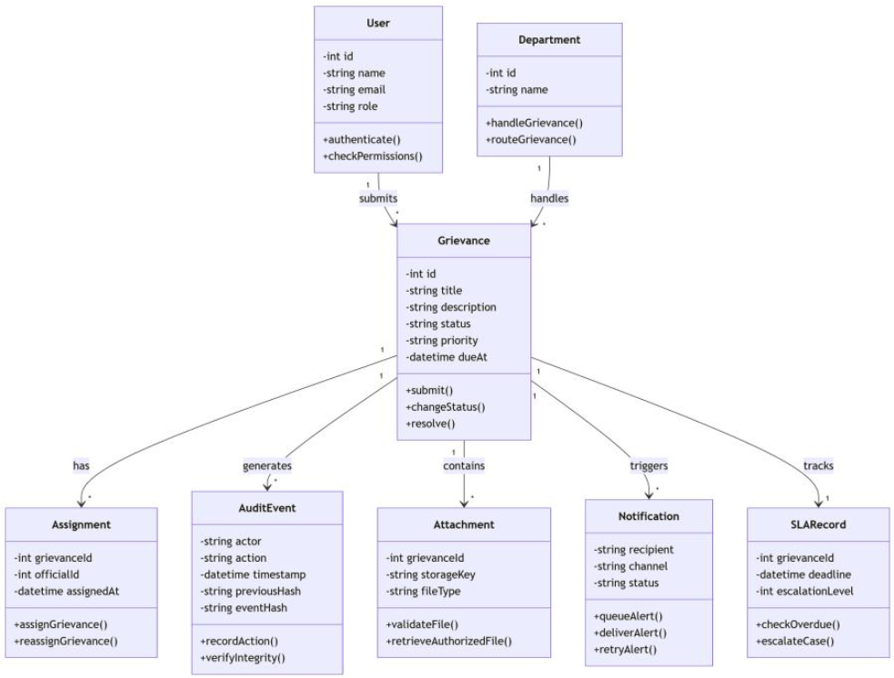

# Grievease

Grievease is a campus grievance-management application. Students can submit
grievances and track their progress. Authorized college officials can review
assigned cases and record status updates, while administrators can manage
official accounts, assignments, and escalation settings.

## Project layout

- `Frontend/` — React and Vite web application.
- `Backend/` — Express API, authentication, grievance services, and MongoDB
  models.
- `Backend/test/` — Workflow, service, and HTTP integration tests. Tests use an
  in-memory mock database and do not require MongoDB.

## Run locally with the mock database

This mode lets you use the frontend and backend together without installing or
configuring MongoDB. Open two terminals from the project root:

```powershell
npm.cmd --prefix Backend run dev:mock
npm.cmd --prefix Frontend run dev
```

Open the frontend URL printed by Vite (normally `http://localhost:5173`).
The mock API runs on port `3000` by default.

### Demo accounts

| Role | Email | Password |
|---|---|---|
| Student | `student@example.test` | `demo-password-123` |
| Administrator | `admin@example.test` | `admin-password-123` |

### Try the administrator workflow

1. Sign in as the administrator and open **Administration**.
2. Create an official account with a department and a password of at least 12
   characters.
3. Sign out and sign in as the demo student. Submit a grievance.
4. Sign back in as the administrator and assign the grievance to the official.
5. Sign in with the official account you created. Update the grievance through
   the permitted workflow: **Under Review → In Progress → Resolved**.

Mock data exists only in memory and is removed when the mock API stops. Mock
credentials and the mock server are for local testing only; do not deploy them
or use these credentials with a production service.

## Run with MongoDB

1. Copy `Backend/.env.example` to `Backend/.env` and set `MONGO_URI` and a
   private `JWT_SECRET` of at least 32 characters.
2. Copy `Frontend/.env.example` to `Frontend/.env` and set
   `VITE_API_BASE_URL=http://localhost:3000/api`.
3. Start the API and frontend in separate terminals:

```powershell
npm.cmd --prefix Backend run dev
npm.cmd --prefix Frontend run dev
```

## Deploy frontend and backend separately

Configure these values in the corresponding hosting services. The frontend API
URL is embedded at build time, so set it before building the frontend.

| Service | Variable | Value |
|---|---|---|
| Frontend | `VITE_API_BASE_URL` | Backend public URL including `/api`, e.g. `https://api.example.com/api` |
| Backend | `FRONTEND_ORIGIN` | Exact public frontend origin, without a path, e.g. `https://app.example.com` |
| Backend | `MONGO_URI` | Production MongoDB connection string |
| Backend | `JWT_SECRET` | Private random secret, at least 32 characters |
| Backend | `PORT` | Port provided by the hosting service, if applicable |

The backend permits browser requests only from the origin(s) configured in
`FRONTEND_ORIGIN`. Separate multiple allowed origins with commas. Replace the
placeholder domains in the `.env.example` files with your deployment URLs.
Never commit `.env` files, expose backend secrets in frontend variables, or
use mock credentials in production.

## Tests

Run the backend test suite from the project root:

```powershell
npm.cmd --prefix Backend test
```

The suite covers grievance workflow rules, core services, and HTTP integration
flows including login, CORS preflight, grievance submission, administrator
official creation and assignment, and official status updates. It runs against
the in-memory mock database and does not connect to MongoDB.

## UML diagram


